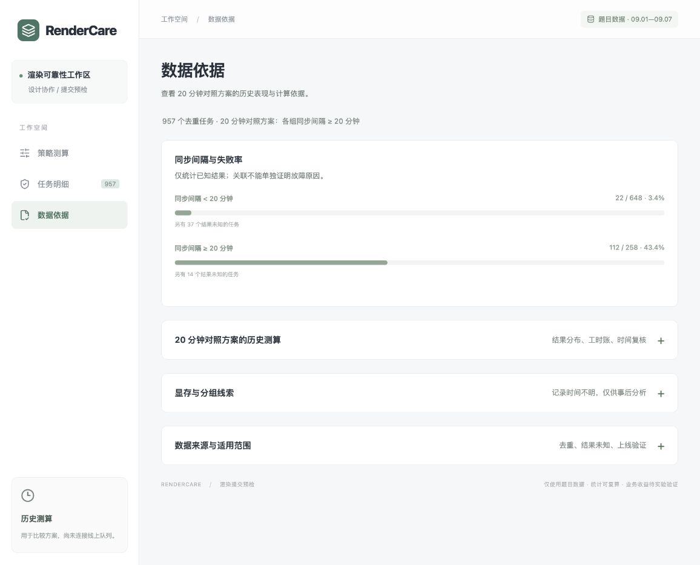

# RenderCare：云端渲染提交预检

为三维设计师提供渲染失败风险的检查线索，并计算检查投入与可能减少的返工工时。交付包括三页工作台、预检 API、原始数据和可复算脚本。

**当前为历史测算与操作原型，未接入线上渲染队列。** 规则能找到值得检查的任务；实际能否修复、是否减少等待或改善客户体验，需要后续记录验证。

## 本次维护改了什么

本次为 **2026-10-21 页面精简版**，基于上一维护版 `da770b0` 整理。重点是移除尚未形成完整使用流程、容易分散注意力的演示与辅助展示，让「策略测算 / 任务明细 / 数据依据」的用途更直观。

- **任务明细**：移除「试一次提交前预检」演示及任务详情中的跳转入口，集中展示任务、历史结果、模型面数与剩余显存。
- **数据依据**：移除「其他假设与额外投入」交互试算，保留历史对照、显存线索和数据适用范围。
- **侧栏**：移除没有账号功能的固定头像与身份说明，保留三页导航。

同时清理上述模块专用的状态与样式，更新当前页面预览。现有策略门槛、原始数据和工时算法保持一致，实际新增检查与处理仍须计入成本。

完整变更与验证见 [CHANGELOG.md](CHANGELOG.md)，AI 提示词及修正见 [AI_LOG.md](AI_LOG.md)。初版 `7a74cc6` 于 2026-10-19 22:28（北京时间）登记提交；本次不冒充时限内初版。

## 运行与使用

需要 **Node.js 24**（见 `.nvmrc`，最低 22.13）。正式发放的数据已包含在仓库中，不需要密钥或外部服务。

```bash
npm ci
npm run verify:render
npm run build
npm start
```

打开 [本地工作台](http://127.0.0.1:4317/)。开发模式使用 `npm run dev`；端口冲突可用 `PORT=4318 npm start`。

| 页面 | 可以做什么 |
| --- | --- |
| 策略测算 | 调整各团队同步间隔门槛，即时查看正确预警、多余检查、检查工时与净节约；点击数量查看对应任务。 |
| 任务明细 | 按方案、团队、预警范围与历史结果筛选；直接对比模型面数和剩余显存，打开任务查看完整来源。 |
| 数据依据 | 查看固定 20 分钟方案的回算、分层与时间复核，以及显存分析和数据适用范围。 |

**初始设置**：KA 同步门槛为 8 分钟，其余三组为 20 分钟；8 分钟是待比较的业务设置，并非数据证明的最优值。已有浏览器会保留自己调整的门槛。可用「全部设为 20 分钟」回到对照方案。人工跟进独立配置，不是同步门槛。

预检 API、保存报告和 CSV 导出固定使用统一 20 分钟方案。任务明细默认查看当前分组方案，两者在页面中明确区分。本机检查标记只保存在浏览器，不代表任务已修复或已真实派单。

[任务明细预览](docs/previews/render-queue-simplified.jpg)



## 我的判断

**优先检查资产同步状态。** 提交距上次资产同步较久，与历史失败有明显关联，可以先用简单、可解释的规则找出检查对象。这里只能证明关联，不能断言缓存过期导致崩溃。

唯一业务数据来源为题目发放的 [render_jobs.csv](data/render_jobs.csv)：

| 项目 | 结果 |
| --- | ---: |
| 原始数据行数 | 1005 |
| 完全重复记录 / 合并后的唯一任务 | 48 / 957 |
| 历史渲染成功 / 失败 / 结果未知 | 772 / 134 / 51 |
| 同步间隔小于 20 分钟，已知结果失败率 | 22 / 648 = 3.40% |
| 同步间隔达到 20 分钟，已知结果失败率 | 112 / 258 = 43.41% |

两个失败率的分母均排除未知结果；检查工时包括所有被规则选中的任务。时间先统一为同一绝对时刻再相减，同 ID 内容冲突会直接报错。

KA 与海外定制项目的服务需求由负责人判断。工作台提供检查范围、历史结果和投入作为依据；客户价值、续约收益没有数据，不折算为工时，也不据工时净值自动削减必要服务。

## 做了什么

1. **提交前预检 API**：读取提交时间与资产同步时间，同步间隔达到 20 分钟时提示检查。历史结果不作为预检输入；网页中的单任务演示已移除，API 仍供复现和接入验证。
2. **分组方案比较**：四组门槛可调，商业卡与总表共享 KA 参数，任务明细随方案联动。海外定制的同步门槛统一在总表调整。
3. **结果与成本账**：逐条区分正确预警、多余检查、漏掉的失败与结果未知；全量和分组工时可复算，不把未知当成功，也不漏扣其检查成本。
4. **显存事后分析**：查看海外定制低显存任务的历史结果及测算，保留采集时间风险。该分析不加入同步方案总账，避免重叠任务重复计费或计收益。
5. **人工跟进模拟**：负责人设置适用团队与提交后等待时限，再手动输入一条模拟任务查看建议。没有完成时间或真实跟进记录，实际新增次数与成本显示暂无数据。

## 怎么证明有用

### 先把历史检查结果和成本算清楚

页面用词统一如下：

| 页面用词 | 在历史测算中表示什么 |
| --- | --- |
| 正确预警 | 规则选中了历史渲染失败的任务，不等于已修复。 |
| 多余检查 | 规则选中了历史渲染成功的任务；相对于避免该次崩溃，会增加检查成本。 |
| 漏掉的失败 | 历史渲染失败，但规则没有选中。 |
| 结果未知 | 未回传结果，不算成功或失败；被选中检查仍计成本。 |

“预警”是规则提示，“检查”是人工动作。按题目口径，每次崩溃损失 120 工时，每次提前拦截检查花费 20 工时。主账按正确提前拦截避免本轮崩溃测算：

```text
每次正确提前拦截净省 = 120 − 20 = 100 工时
净节约工时 = 正确预警数 × 100 − 多余检查数 × 20 − 预警中结果未知数 × 20
```

| 方案 | 检查次数 | 正确预警 | 多余检查 | 预警中结果未知 | 检查工时 | 净节约工时 |
| --- | ---: | ---: | ---: | ---: | ---: | ---: |
| 统一 20 分钟对照方案 | 272 | 112 | 146 | 14 | 5440 | 8000 |
| KA 8 分钟，其余 20 分钟（初始设置） | 370 | 115 | 234 | 21 | 7400 | 6400 |

对照方案可用两种算法交叉核对：

```text
112 × 100 − 146 × 20 − 14 × 20 = 8000
134 × 120 −（22 × 120 + 272 × 20）= 8000
```

第二行明确计入漏掉的 22 次失败。正确预警的 100 已经扣过它自身的 20，不能再重复扣全部检查成本。**以上是历史测算，不是已经实现的线上节省。** 真实发生的额外核查、重复检查和修复人工仍须另计；同一次检查被两条规则选中只计一次，再实际检查一次则再计一次。

「数据依据」的时间复核表保留固定的 50% 假设作对照：`112 × 120 × 50% − 272 × 20 = 1280`。50% 不是实测修复率。额外假设与人工投入的交互试算模块已移除，实际新增成本仍须另行记录。

### 验证范围与复现

9 月 1—5 日用于开发期规则比较，9 月 6—7 日用于时间复核。原有 35 项候选中，按开发期 100% 有效情景净工时比较，统一 20 分钟方案胜出；后两天对应净值为 2200。此前探索已看过全量分布，因此后两天不是严格未见测试集；含显存候选还存在采集时点风险。

```bash
npm run check                     # 57 项测试 + TypeScript + 生产构建
npm run verify:render             # 原文件校验、复算并核对已保存证据
python3 scripts/verify_render.py  # Python 标准库独立重读 CSV 复核
```

本轮页面删减已通过 57 项既有测试、TypeScript 与生产构建；维护整理时再次通过原文件及保存结果核对、独立 Python 复算。测试覆盖时间/去重、未知成本、逐任务总账、全部分组门槛、显存候选、跟进配置边界与工时差额展示。本轮浏览器复核覆盖三页切换、任务详情、删除入口和控制台错误；窗口宽度为 1156px。此前的 390px 窄屏验证记录保留在 [CHANGELOG.md](CHANGELOG.md)。

| 证据 | 路径 |
| --- | --- |
| 计数、失败率、候选和分层结果 | [render-metrics.json](results/render-metrics.json) |
| 每个任务与原始记录对应关系 | [render-audit.csv](results/render-audit.csv) |
| 固定 20 分钟方案的 272 个任务 | [interception-queue.csv](results/interception-queue.csv) |
| 固定报告计算 / 分组方案计算 | [server/render.mjs](server/render.mjs) / [src/threshold-strategy.mjs](src/threshold-strategy.mjs) |
| 独立复核 | [scripts/verify_render.py](scripts/verify_render.py) / [tests/threshold-strategy.test.mjs](tests/threshold-strategy.test.mjs) |
| 完整有效比例区间与团队差异 | [复核补充](docs/复核补充.md) |

## 数据边界与下一步

- **显存记录时间未知。** 若运行中或失败后才得到该值，就不能回填为提交前预测信息。原值为 0—30 MB、模型面数为 7—108，沿用题目单位，不擅自解释为 GB、千面或万面；没有任务所需显存，不能直接认定显存不足。
- 同步间隔是「提交时间减去资产同步完成时间」，与「提交后等了多久」分开判断。同步快照是否在提交时已知也需要上线核验。
- CSV 没有错误码、完成时间、人工处理记录、客户编号或续费数据，不能证明失败根因、实际挽回客户或因果收益。19、20、21 分钟无观测，不能认定 20 是精确最优临界点。
- `examples/`、`exam-kit/` 中的人工示例和测试样本不进入本题分析；人工跟进模拟同样不计入历史结论。

下一步先影子运行，记录决策时可用的字段快照、实际检查动作、重复次数、人工耗时与最终交付；再在保留必要服务保障的前提下比较提示核查与原流程，同时监测返工、等待和首次成功率。工时、交付和客户体验需要一起评估。

原始文件 SHA-256：`f7674deda7ae2f49cd878073083550acd7e82d765e8675fa694736485cd4b658`。

多轮旧版说明与完整历史验证已保存在 [历史 README](docs/history/README-2026-10-20.md)，考前准备见 [准备阶段说明](docs/准备阶段说明.md)。当前功能以本页及 [CHANGELOG.md](CHANGELOG.md) 为准。
