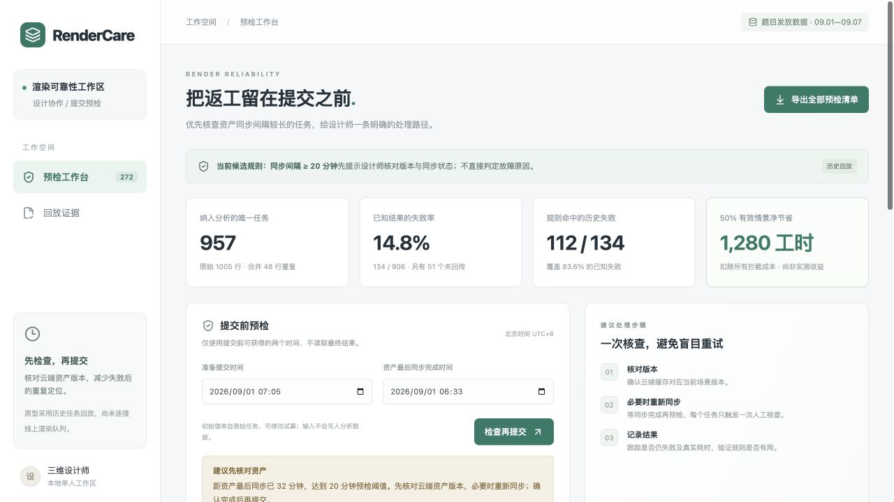

# RenderCare：云端渲染提交预检

帮助三维设计师在提交前发现值得核查的资产同步状态，减少失败后的定位与重提。交付包含可运行网页、提交前预检 API、逐任务证据清单和一键复算。**当前是历史数据回放与预检原型，未连接线上渲染队列，未证明实际节省工时。**

初版 `7a74cc6` 于 2026-10-19 22:28（北京时间）在题目页面登记为评分版本。此后的有效比例区间、团队差异、分层复核及业务保障功能属于**提交后持续优化**，详见文末记录及 [`docs/复核补充.md`](docs/复核补充.md)。

## 运行与复算

需要 Node.js 24（见 `.nvmrc`，最低 22.13），不需要密钥或额外服务。正式发放数据已原样包含在仓库中。

```bash
npm ci
npm run verify:render   # 原文件校验 + 重算并核对三个已保存证据文件
npm run build
npm start
```

打开 <http://127.0.0.1:4317>。开发模式使用 `npm run dev`；端口冲突可用 `PORT=4318 npm start`。启动时自动从正式 CSV 计算结果，不依赖已存在的 SQLite 或浏览器缓存。核查标记只保存在当前浏览器，不参与任何业务结论或复算。

```bash
npm run analyze:render       # 重新生成 JSON 报告、逐任务审计与拦截清单
npm run check                # 自动测试 + TypeScript + 生产构建
python3 scripts/verify_render.py  # 可选：仅 Python 标准库的独立实现复核
```

前端和分析命令都使用 [`server/render.mjs`](server/render.mjs) 的同一政策与成本函数；独立 Python 脚本不导入该实现。



[查看回放证据截图](docs/previews/render-evidence.png)

提交后补充截图：[规则有效比例区间](docs/previews/render-review-evidence.png)、[团队收益与分层关联](docs/previews/render-team-evidence.png)。

## 我的判断

**优先做“同步间隔 ≥20 分钟时提示核对资产版本”，暂不做复杂失败分类器或按团队一刀切拦截。** 这个方向能给设计师明确的下一步；前提是上线时读取的是提交时可用的资产同步快照，CSV 本身不能证明字段没有被事后更新。同时它有大量误拦，因此先做可解释提示与实验，不直接上线强制拦截。

数据支持的事实：

| 项目              | 结果与口径                                                             |
| ----------------- | ---------------------------------------------------------------------- |
| 原始行数          | 1005 行数据，不含表头                                                  |
| 分析单位          | 957 个唯一 `job_id`；48 行是完全相同的重复记录，合并后计一次任务与成本 |
| 最终结果          | 772 成功、134 失败、51 未回传                                          |
| 已知结果失败率    | 134 / 906 = **14.79%**；未回传不算成功或失败                           |
| 同步间隔 <20 分钟 | 22 / 648 = **3.40%** 失败；另有 37 个未知                              |
| 同步间隔 ≥20 分钟 | 112 / 258 = **43.41%** 失败；另有 14 个未知                            |

上述结果见 [`results/render-metrics.json`](results/render-metrics.json) 的 `source`、`outcomes`、`lagGroups`。如果把全部 51 个未知任务分别视为成功/失败，全体 957 个任务的失败比例范围是 **14.00%—19.33%**；不能假定缺失是随机的。

**根问题的工作假设**：提交时资产版本/同步状态可能需要更早核查，设计师缺少可直接采取行动的失败前提示。数据证实的是“较大同步间隔与失败相关”，没有提供资产修改时间、版本差异或错误码，**不能认定缓存过期导致崩溃**。最后同步完成时间距提交较久也可能完全正常。数据仅覆盖 9 月 1—7 日，没有更早基线，不能据此证明题目背景中的“近期上升”。

显存和多边形面数也作了检查。显存原值为 0—30 MB、面数为 7—108（JSON 的 `featureRanges`），沿用题目单位，不擅自解释成 GB、千面或万面；没有任务所需显存，不能仅凭剩余显存推断资源不足。团队和场景统计完整保存在 JSON，未把团队身份作为拦截条件。

## 做了什么

1. **提交前预检**：输入准备提交时间和资产最后同步完成时间，带时区计算分钟差；达到 20 分钟提示核对云端版本、必要时重新同步。输入缺失、无时区或时间倒置返回“需核对”，不默认为安全。预检决策不读取 `is_success`。
2. **核查清单**：列出 272 个历史命中任务，支持按团队、历史结果、编号/场景搜索，查看原始时间、显存、面数、来源记录序号与触发理由，导出完整 CSV。已核查只是本机状态，不代表已经同步或修复。
3. **回放证据**：展示已知失败覆盖率、成功任务误拦、未知结果、时间复核、不同有效比例的工时测算与基线对比。允许调整假设有效比例，看到收益如何转负。
4. **可复核输出**：原始 CSV 原样保留；按唯一任务去重；输出全部任务审计清单与全部命中任务，保留重复来源记录序号。
5. **业务保障与权重（提交后新增）**：KA、定制权重滑块改变历史清单的查看顺序，并显示按业务重要性计算的历史失败覆盖；独立演示重点项目提交后 10 分钟仍无结果时的人工跟进建议。业务假设、人工演示和正式数据分别标明。

网页中“历史结果”只用于核对规则表现，不作为预检输入。输入框初值来自原始任务，手工试算不写入分析数据。没有接入真实资产刷新、渲染提交或调度接口，也没有用按钮伪装这些动作已经完成。

## 提交后新增：业务保障与权重

用户指出，KA 项目及潜在 KA 的定制项目有更高的交付优先级；新功能验证、客户等待和成交风险没有被统一的 120/20 工时账覆盖。因此，**团队情景净工时为负，不能成为取消必要检查或把问题交给客户自行处理的依据。** 新功能先定义服务保障，再用权重表达关注顺序。

在网页左侧打开“业务保障与权重”：

| 参数 | 初值 | 含义与来源 |
| --- | ---: | --- |
| KA 权重 | 100 | 用户提出的重要性假设；滑块和数值输入可调 1—500 |
| 定制权重 | 30 | Codex 提议的初始情景，尚非确认的业务标准；可调 1—500 |
| 普通任务权重 | 1 | 国内电商组、生态服务商组作为本次情景基准 |
| 重点项目无结果核查时限 | 10 分钟 | 用户提出的主动跟进要求；可调 1—30 分钟 |

设置保存在当前浏览器，可以恢复默认。当前只能用 `team_id` 代理项目属性；一个业务组不等于一个客户或一个项目，100× 也不代表已证实的客户数量、收入比例或实际工时倍数。

### 权重实际改变什么

- 历史命中清单按“权重从高到低、同权重先提交先展示、同时间按任务编号”排序。默认 KA 在前、定制其次；把定制调到 200 后，定制排在 KA 100 之前。该顺序没有使用历史成功/失败标签，也不改变真实渲染调度。CSV 导出仍是完整的原始规则命中证据，不包含本机业务权重。
- 新增加权历史失败覆盖：`Σ(规则圈到的已知失败数 × 权重) / Σ(全部已知失败数 × 权重)`。默认是 `(33×100 + 13×30 + 31 + 35) / (38×100 + 25×30 + 35 + 36) = 3756/4621 ≈81.3%`；全部设为 1 则回到 `112/134 ≈83.6%`。它只表示当前规则覆盖了多少被赋予重要性的历史失败，不表示修复效果，也不证明这个权重最优。
- 原始任务数、固定同步规则、35 项候选选择和实际工时单位不乘权重。50% 有效情景仍为 1280 工时。没有用任意权重制造“省更多工时”的结论。

### 两只时钟与具体接手流程

原规则看**提交时距离上一次资产同步多久**；新增保障看**提交后已经等结果多久**。即使提交前刚同步过，重点项目等了 10 分钟仍无结果，也应建议核查，不受同步规则是否命中、权重大小或工时盈亏限制。

| 当前任务情况 | 建议动作 |
| --- | --- |
| KA / 定制，仍在排队或执行，达到时限 | 平台支持先查队列、执行进度和日志，必要时转研发；不自动停渲染，不直接要求客户重传 |
| KA / 定制，尚未达到时限 | 继续监测；原有项目检查继续进行，提前报错就立即处理 |
| 任意团队已明确失败 | 立即进入故障处理，无需等满 10 分钟 |
| 已有人员处理上述故障或超时 | 保留当前负责人继续跟进，不重复建议派单 |
| 已返回成功结果 | 结束“无结果”跟进，按项目要求另行验收质量 |
| 普通任务仍未回传 | 按既有服务流程继续跟进；本次没有定义其新的时限，不能据此取消检查 |

页面的单任务演示使用明确标记的**人工输入**，不会真实派人、发通知、停止任务或进入分析数据。正式 CSV 没有观察时刻、结果回传时间、当前执行状态或负责人；51 个历史未知结果不能当作今天仍在等待。当前无法回算这条 10 分钟保障触发多少次、实际减少多少返工。KA 和定制共有 17 个历史失败未被同步规则圈到，这支持“同步预检不能代替服务保障”，但不证明新增时限能够挽救这 17 个任务。

上线时需接入真实任务状态，记录负责人、处理动作、各方实际投入、客户额外操作和交付时间。排班容量不足时应升级协调，不能只按权重长期推迟普通客户；真实排队还需服务时限和等待升级机制。先验证是否减少设计师返工、客户负担和交期延误，不把平台减少投入当作唯一目标。

[权重设置界面](docs/previews/render-service-policy.png) · [10 分钟跟进演示](docs/previews/render-service-followup.png)

## 怎么证明有用

### 规则选择与时间复核

按北京时间自然日划分：9 月 1—5 日为开发期，9 月 6—7 日做时间复核。同一 `job_id` 先去重，再划分，重复记录不会跨集合。

候选共 **35 项**：不拦截、全部拦截；同步间隔阈值 10/15/20/25/30/40/60 分钟；剩余显存阈值 0/1/2/3/5/8 MB；同步阈值 15/20/25/30 与显存阈值 0/1/2/3/5 的 OR 组合。按开发期 **100% 有效情景净工时最大**选择，平局取拦截数较少的规则；同步 ≥20 分钟胜出。候选全集和开发期结果均在 JSON 的 `candidates` 中。

**限制：探索时已经看过全量分布，后两天只能称作时间复核，不是严格未见的测试集，也不是上线效果验证。** 后两天在 100% 有效情景下，“同步 ≥20 分钟或显存 ≤1 MB”为 2340 工时，固定同步规则为 2200。没有用这个结果重新选规则，也没有证据断言 140 工时的差异一定是噪声。全部候选的开发期、复核期结果均可重算。

### 把每一次拦截成本都算进去

题目给定：失败一次损失 120 工时，每次提前拦截花费 20 工时。假设 α 为拦截后真正避免原有失败的比例：

```text
净节省工时 = 命中的已知失败数 × 120 × α − 全部拦截数 × 20
```

成功任务被拦截也扣成本；未知任务被拦截同样扣成本，但不计算避免失败的收益。一个唯一任务只计一次拦截。这是场景假设，不假装同步一定能修复失败。

网页提示不等于设计师实际执行了核查。当前仍按题目每次 20 工时记账，不因“只提醒”就自行降低成本；真实提醒响应、核查与同步耗时、额外排队延迟需要另行测量。α 表示全部命中失败中最终被干预避免的比例，因此也受是否执行核查影响。未知任务不计收益仅是这部分的保守记账，不构成真实总收益的统计下界。

| 范围                 | 唯一任务 | 拦截数 | 命中失败 | 误拦成功 | 命中未知 | α=100% 净工时 | α=50% 净工时 |
| -------------------- | -------: | -----: | -------: | -------: | -------: | ------------: | -----------: |
| 开发期 09.01—09.05   |      688 |    196 |       81 |      101 |       14 |          5800 |          940 |
| 时间复核 09.06—09.07 |      269 |     76 |       31 |       45 |        0 |          2200 |          340 |
| 全部历史             |      957 |    272 |      112 |      146 |       14 |          8000 |         1280 |

全量例子：`112 × 120 × 50% − 272 × 20 = 1280`。全部已知失败原始损失为 `134 × 120 = 16080` 工时；50% 情景下被避免的损失为 6720 工时，拦截成本为 5440 工时，因此剩余损失加拦截成本为 14800 工时。

- 规则覆盖已知失败 **112/134 = 83.58%**，漏过 22 个已知失败。
- 命中中已回传任务的失败比例为 **112/258 = 43.41%**；146 个原本成功的任务也会被打扰。
- α=0% 时净损失 **5440** 工时；α=25% 时为 **−2080**；α=50% 为 **1280**；α=75% 为 **4640**；α=100% 为 **8000**。全量盈亏平衡需要 α **>40.48%**，后两天需要 **>40.86%**。
- 同一全量、α=100% 的口径下，不拦截的增量收益为 **0**，全部拦截为 **−3060**，仅“显存 ≤3 MB”为 **1540**，选定规则为 **8000**。所以目标不是拦截越多越好。

**8000 和 1280 均为历史情景测算，不能写成已实现节省；50% 也不是从数据估计的修复率。** 这份数据能证明规则的命中与成本账算得清，不能证明干预的因果效果。

### 提交后补充 有效比例变化时选什么规则

在开发期 688 个任务、原有 35 项候选和统一 α 假设下，计算所有候选收益直线的交点，得到完整区间；不是只抽查 25%、50%、75%、100% 几个值。

| α 区间内部        | 开发期最优候选 | 拦截数 | 命中失败 | 开发期净工时公式 |
| ----------------- | -------------- | -----: | -------: | ---------------- |
| 0%—40%            | 不拦截         |      0 |        0 | 0                |
| 40%—41.6667%      | 同步 ≥30 分钟  |    168 |       70 | 8400α − 3360     |
| 41.6667%—44.4444% | 同步 ≥25 分钟  |    188 |       78 | 9360α − 3760     |
| 44.4444%—100%     | 同步 ≥20 分钟  |    196 |       81 | 9720α − 3920     |

精确切点为 `2/5`、`5/12`、`4/9`。切点处相邻候选并列，按较少拦截分别选“不拦截”“≥30 分钟”“≥25 分钟”；α=0 与 α=1 分别属于两端规则。**20 分钟规则的开发期盈亏点 40.33% 不等于最优规则切换点 44.44%。** 例如 α=40.3% 时，30 分钟规则为 +25.2 工时，20 分钟规则为 −2.84 工时。

预检仍使用初版固定的 20 分钟规则；新增区间用于揭示取舍，不在浏览滑杆时偷偷更改规则。结论仅限这些候选和历史样本，也假设不同规则的 α 相同，不能消除选择偏差或保证未来最优。结果见 JSON 的 `ruleSensitivity`；Python 使用精确分数、端点比较和全部候选进行独立验证。

### 提交后补充 团队差异和分层关联

以下固定采用同步 ≥20 分钟规则。失败率只用已知结果作分母；成本包括全部命中任务。

| 团队         | <20 分钟失败率 | ≥20 分钟失败率 | 命中总数 | 命中失败 | 命中未知 | α=50% 净工时 | 盈亏平衡 α |
| ------------ | -------------: | -------------: | -------: | -------: | -------: | -----------: | ---------: |
| KA大客户组   |  5/180 = 2.78% | 33/58 = 56.90% |       62 |       33 |        4 |          740 |     31.31% |
| 国内电商组   |  4/171 = 2.34% | 31/62 = 50.00% |       66 |       31 |        4 |          540 |     35.48% |
| 海外定制组   | 12/149 = 8.05% | 13/68 = 19.12% |       69 |       13 |        1 |     **−600** | **88.46%** |
| 生态服务商组 |  1/148 = 0.68% | 35/70 = 50.00% |       75 |       35 |        5 |          600 |     35.71% |

海外定制组风险差值约 11.06 个百分点，低于其余三组的 47.66—54.12 个百分点。该团队一共 233 个任务，命中 69 个，其中已知 68 个；不能把 68 当作该团队总样本量。其余三组合计命中 203 个、命中失败 99 个、命中未知 13 个，50% 情景净工时 1880、盈亏点约 34.18%。

这说明统一规则的情景收益存在团队差异，不能把总体正收益推广到每个团队。风险差异也不等于真实修复效果的差异。当前不据此直接排除某团队或制定新的团队阈值，下一步先分组检查任务结构、字段语义和实际干预效果。

| 分别按单一维度分层 | 可比较分组 | ≥20 分钟组失败率更高的分组 |
| ------------------ | ---------: | -------------------------: |
| 团队               |          4 |                          4 |
| 场景               |          8 |                          8 |
| 北京时间日期       |          7 |                          7 |

分层后关联同向，支持它不只是汇总层面的现象；**仍不能排除联合混杂、分组内部或未观测因素，更不能据此认定因果根因。** 逐组分子、分母、未知数及收益见 `byTeam`、`byScene`、`byDay`，汇总见 `stratification`。

### 数字与证据的对应关系

| README 中的数字            | 机器可读来源                                               | 复核方式                                              |
| -------------------------- | ---------------------------------------------------------- | ----------------------------------------------------- |
| 行数、去重、成功/失败/未知 | `render-metrics.json` 的 `source`、`outcomes`              | `npm run verify:render`                               |
| 高低同步间隔失败率         | `lagGroups`                                                | 分别用 `failed / known`                               |
| 前 5 天、后 2 天、全量工时 | `train`、`validation`、`all`                               | `caughtFailures × 120 × α − intercepted × 20`         |
| 基线与候选选择             | `baselines`、`candidates`                                  | 按开发期收益排序                                      |
| 逐任务与重复来源           | [`render-audit.csv`](results/render-audit.csv)             | `source_rows` 为不含表头、从 1 开始的原始数据记录序号 |
| 全部 272 个命中任务        | [`interception-queue.csv`](results/interception-queue.csv) | 逐行核对 `sync_age_minutes ≥20`                       |
| 有效比例完整区间及端点平局 | `ruleSensitivity`                                          | Python 精确分数复核全部候选、连续区间与切点           |
| 团队差异及分层关联         | `byTeam`、`byScene`、`byDay`、`stratification`             | 逐组重算已知结果失败率和全部命中成本                  |

独立校验：[`scripts/verify_render.py`](scripts/verify_render.py) 只用 Python 标准库重读 CSV，独立处理时区和去重，核对三段任务计数、分母、工时、命中集合；并重建 35 项候选，验证有效比例区间及团队/场景/日期分层结果。

## 数据与边界

唯一业务数据来源：题目发放的 [`data/render_jobs.csv`](data/render_jobs.csv)，原文件 SHA-256：

```text
f7674deda7ae2f49cd878073083550acd7e82d765e8675fa694736485cd4b658
```

- 两种时间格式统一为同一绝对时刻后相减；例如 `2026-09-01T07:00:00+08:00` 与 `2026-08-31T23:00:00Z` 为同一时刻，间隔为 0，不是 8 小时。
- 48 个重复业务编号的记录内容完全一致；遇到同 ID 内容冲突时脚本直接失败，不任意覆盖。
- 未回传原始有 55 行，去重后有 51 个任务。`is_success` 空值保留为未知。
- 发放文件无缺失时间、无负时间间隔；没有凭空补齐数据。输入原文件变化会因校验值不一致而停止。
- 阈值附近观测从 18 分钟跳到 22 分钟，19、20、21 分钟无记录。因此 `>18 分钟` 与 `≥20 分钟` 仅在本数据中等价，不能识别精确临界点，也不能仅凭空档认定数据是人工生成的。
- 仓库中的 `examples/`、`exam-kit/data/sample_orders.csv` 和测试内的小样本来自考前准备/人工边界测试，**不进入本题分析、截图中的指标或业务结论**。当前首页已替换为正式 RenderCare 页面。

## 验证与取舍

已运行 `npm run check`：**40 项 Node 测试通过**；TypeScript 和生产构建通过。初版 30 项、首轮持续优化增加 2 项，本次业务保障增加 8 项：无结果时限边界、权重不能取消保障、普通失败立即处理、避免重复跟进、输入校验、两只时钟独立、排序与加权覆盖。新增测试直接重读正式 CSV 复核默认加权覆盖，并确认 272 条命中及 1280 工时不变。`npm run verify:render` 与 Python 独立复核通过。

浏览器已核对原有 41%/43%/50% 情景规则切换和团队收益联动；本次验证权重滑块与数值同步、定制 200 后的清单排序、刷新保留设置、9/10 分钟边界、时限滑块、已有人跟进、普通失败和已成功状态。测试后恢复 KA 100、定制 30、时限 10 分钟。

优先交付能帮助设计师行动的一条闭环。没有花时间训练黑箱模型、部署账号系统或模拟真正的渲染调度。服务默认只监听本地，适用于单人演示；前端的已核查标记不是多人协作状态。考前模板与通用分析工具保留在仓库中，准备记录见 [`docs/准备阶段说明.md`](docs/准备阶段说明.md)。

## 下一步与持续优化

先影子运行，确认提交时快照语义并记录命中、实际失败、任务版本、错误码与真实返工工时；再对命中任务随机分配“提示核查”与“原流程”，按分配组比较任务返工工时，扣除核查成本，并监测交期延迟、重复拦截和首次成功率。如果共享资产造成组间影响，需要考虑按资产或团队分组随机。固定 20 分钟规则的全量情景盈亏点约为 40.5%，各团队不同，不能用开发期最优区间代替真实实验。真实部署还需要对任务/版本设置一次性核查与重试上限，避免循环拦截。

**初版 `7a74cc6`**：完成去重/时区处理、35 项候选比较、时间复核、成本敏感性分析、预检网页/API 和可复算证据，已在 2026-10-19 22:28（北京时间）提交。

**2026-10-19 提交后持续优化**：独立复核外部 AI 审查，修正其“α≥40.3% 时 20 分钟规则始终最优”的错误建议；加入精确的规则切换区间、含未知成本的团队收益、单维度分层比较及证据边界。网页同步显示区间和团队收益，报告升级为 schemaVersion 2，扩充独立 Python 复算及回归测试。原始数据、固定预检阈值、272 条命中清单和初版整体工时数值保持一致。尚未进行线上实验；不把这些后续补充冒充时限内初版。

**2026-10-20 提交后持续优化**：根据用户对客户重要性与人工核查价值的反馈，新增 KA / 定制权重滑块、历史清单排序、加权失败覆盖和独立的 10 分钟无结果跟进演示。改写团队情景账的说明，明确不能据负工时情景削减重要项目服务。保留题目成本与所有原始证据；新业务参数为假设，未声称得到新的线上收益或已连接派单系统。

AI 交互与修正记录见仓根 [`AI_LOG.md`](AI_LOG.md)。
