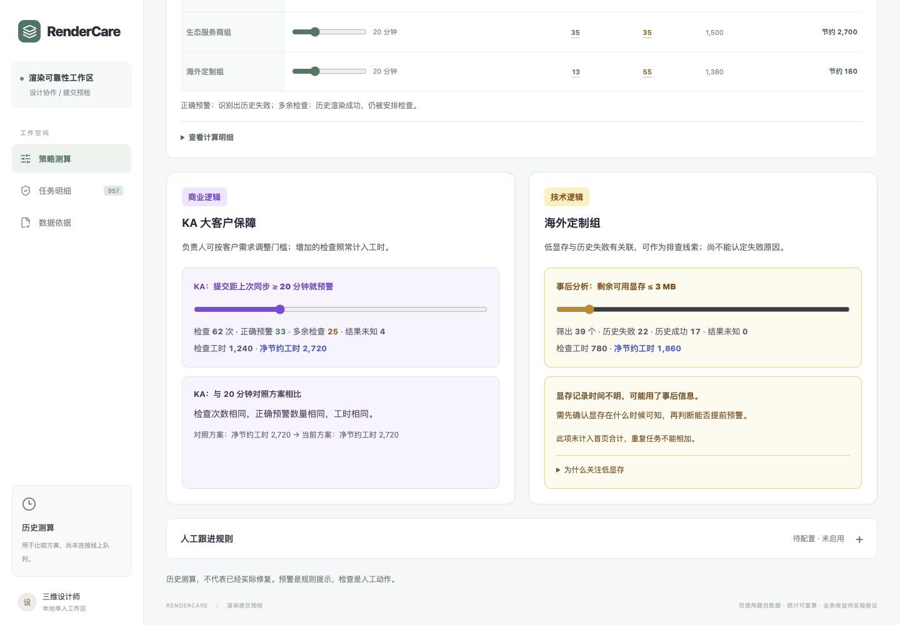

> 维护整理前的历史记录，保存于 2026-10-20。包含多轮旧版说明、旧术语与已移除的设置，不代表当前界面；当前使用说明见[仓根 README](../../README.md)，本次改动见[维护记录](../../CHANGELOG.md)。

# RenderCare：云端渲染提交预检

帮助三维设计师在提交前发现值得核查的资产同步状态，减少失败后的定位与重提。交付包含可运行网页、提交前预检 API、逐任务证据清单和一键复算。**当前是历史测算与预检原型，未连接线上渲染队列，未证明实际节省工时。**

业务上希望通过投入人工、提前识别并处理失败风险来改善交付；工时是投入与返工的计量，不能把“少做检查”直接当作客户收益。成功/失败、风险漏检、核查投入和实际干预效果需要一起看。后续页面增加结果四象限与可交互试算，仍不把客户满意度或续费变化冒充已知事实。

**历史测算按正确预警并提前拦截一次净省 `120 − 20 = 100` 工时计账。** 20 分钟对照方案正确预警 112 个、多余检查 146 个、预警中结果未知 14 个，因此净节约为 `112 × 100 − 146 × 20 − 14 × 20 = 8000` 工时。漏掉的 22 次失败仍按 120 计入采用规则后的总成本。主账采用“正确提前拦截避免本轮崩溃”的口径，不表示已经修复或交付；额外人工、重复检查和后续崩溃不得隐去。原 50% 参数及额外投入表保留在明确标注的扩展情景中，不能作为数据实测结论，也不会覆盖本轮主账。

初版 `7a74cc6` 于 2026-10-19 22:28（北京时间）在题目页面登记为评分版本。此后的有效比例区间、团队差异、分层复核及业务保障功能属于**提交后持续优化**，详见文末记录及 [`docs/复核补充.md`](../../docs/复核补充.md)。

## 运行与复算

需要 Node.js 24（见 `.nvmrc`，最低 22.13），不需要密钥或额外服务。正式发放数据已原样包含在仓库中。

```bash
npm ci
npm run verify:render   # 原文件校验 + 重算并核对三个已保存证据文件
npm run build
npm start
```

打开 <http://127.0.0.1:4317>。开发模式使用 `npm run dev`；端口冲突可用 `PORT=4318 npm start`。启动时自动从正式 CSV 计算结果，不依赖已存在的 SQLite 或浏览器缓存。核查标记只保存在当前浏览器，不参与任何业务结论或复算。

当前工作台统一为三页，默认打开 [策略测算](http://127.0.0.1:4317/?view=strategy)：

- **策略测算**：首屏显示正确预警、多余检查、检查工时和净节约工时（负数显示净增加工时）；拖动各组门槛即时重算。下方用紫色「商业逻辑」与黄色「技术逻辑」两张卡片展示客户保障和显存排查；同页「人工跟进规则」初始待配置，负责人选择团队和跟进时限后用于模拟。
- **任务明细**：点击首页数字直接查看当前方案对应的任务，也可切换到 20 分钟对照方案。「模型与显存」一列分两行展示原始面数与剩余显存（MB），表头可展开显存记录时间说明；保留筛选、详情、本机检查标记和折叠的对照方案单任务预检。
- **数据依据**：先看同步间隔与失败率，其余对照方案历史测算、时间复核、显存线索、避免失败比例（假设）及额外人工投入按需展开。

原预检 API、报告与 CSV 导出仍采用统一 20 分钟；网页当前方案只派生新的圈选标记，不改写原始结果。旧 `?view=service` 链接兼容到首页并展开保障设置。

```bash
npm run analyze:render       # 重新生成 JSON 报告、逐任务审计与拦截清单
npm run check                # 自动测试 + TypeScript + 生产构建
python3 scripts/verify_render.py  # 可选：仅 Python 标准库的独立实现复核
```

原规则报告与预检接口使用 [`server/render.mjs`](../../server/render.mjs)；当前方案通过 [`src/threshold-strategy.mjs`](../../src/threshold-strategy.mjs) 重算门槛，成本复用 [`src/service-policy.mjs`](../../src/service-policy.mjs)。各模块均按 120/20 口径计入全部检查成本，独立 CSV 测试和 Python 脚本交叉核对。



[任务明细](../../docs/previews/render-queue-resources.png) · [数据依据](../../docs/previews/render-three-page-evidence.png) · [此前三页版首页](../../docs/previews/render-three-page-strategy.png)

[查看初版回放证据截图](../../docs/previews/render-evidence.png)

提交后补充截图：[规则有效比例区间](../../docs/previews/render-review-evidence.png)、[团队收益与分层关联](../../docs/previews/render-team-evidence.png)。

## 我的判断

**优先做“同步间隔 ≥20 分钟时提示核对资产版本”，暂不做复杂失败分类器或按团队一刀切拦截。** 这个方向能给设计师明确的下一步；前提是上线时读取的是提交时可用的资产同步快照，CSV 本身不能证明字段没有被事后更新。同时它有大量误拦，因此先做可解释提示与实验，不直接上线强制拦截。

数据支持的事实：

| 项目              | 结果与口径                                                             |
| ----------------- | ---------------------------------------------------------------------- |
| 原始行数          | 1005 行数据，不含表头                                                  |
| 分析单位          | 957 个唯一 `job_id`；48 行是完全相同的重复记录，合并后计一次任务与成本 |
| 最终结果          | 772 成功、134 失败、51 未回传                                          |
| 已知结果失败率    | 134 / 906 = **14.79%**；未回传不算成功或失败                           |
| 同步间隔 <20 分钟 | 22 / 648 = **3.40%** 失败；另有 37 个未知                              |
| 同步间隔 ≥20 分钟 | 112 / 258 = **43.41%** 失败；另有 14 个未知                            |

上述结果见 [`results/render-metrics.json`](../../results/render-metrics.json) 的 `source`、`outcomes`、`lagGroups`。如果把全部 51 个未知任务分别视为成功/失败，全体 957 个任务的失败比例范围是 **14.00%—19.33%**；不能假定缺失是随机的。

**根问题的工作假设**：提交时资产版本/同步状态可能需要更早核查，设计师缺少可直接采取行动的失败前提示。数据证实的是“较大同步间隔与失败相关”，没有提供资产修改时间、版本差异或错误码，**不能认定缓存过期导致崩溃**。最后同步完成时间距提交较久也可能完全正常。数据仅覆盖 9 月 1—7 日，没有更早基线，不能据此证明题目背景中的“近期上升”。

显存和多边形面数也作了检查。显存原值为 0—30 MB、面数为 7—108（JSON 的 `featureRanges`），沿用题目单位，不擅自解释成 GB、千面或万面；没有任务所需显存，不能仅凭剩余显存推断资源不足。团队和场景统计完整保存在 JSON，未把团队身份作为拦截条件。

**显存字段存在未来信息泄漏风险（采集时点未确认）。** CSV 虽将 `gpu_mem_free_mb` 描述为节点当前剩余显存，却没有采集时间、系统获知时间或对应的任务阶段。如果该数值在运行数十分钟后或失败后才得到，用它预测提交前是否失败，就使用了决策时尚不可见的信息。题目数据不能证明它一定来自提交前，也不能证明它一定是事后值。

因此，所有显存阈值、显存与同步的组合、分组相关性及对应工时，均只作为**事后关联/候选比较，提交前可用性待验证**。当前预检接口不读取显存，现有同步规则的任务清单和工时数值不受这项标记影响。此前讨论的“低显存可圈到漏检失败”也只能表示历史数据中的重叠，不能称为已具备提前预警能力；50% 等有效比例假设不能解决采集时点缺失的问题。

示意（非题目记录）：12:00 提交，12:30 才观察到显存不足。该观察可以支持 12:30 之后的运行中处理，不能回填成 12:00 的预测特征。是否来得及避免失败、还剩多少可避免损失，也不能由这张表确定。运行中预警需要显存时序和失败发生时间。

上线前应记录 `gpu_mem_captured_at`（采样时刻）、`gpu_mem_available_at`（系统获知时刻）、`decision_at`（作出判断时刻）、节点及任务阶段。这些是待补采字段，**不是已有数据**。采样和获知都不晚于决策时，才能用于该次判断；若改为运行中预警，应在每个观察时点重新评估。网页总提示、任务详情、显存基线和 JSON 的 `featureTiming.gpu_mem_free_mb` 均保留此标记。原 CSV 不改写、不补造时间。

[查看显存采集时点风险标记](../../docs/previews/render-feature-timing.png)。此次标记通过 46 项测试、构建和独立复算；与上一版本逐项对比，报告仅增加时点说明与两条假设，原有数字未变。

## 做了什么

1. **策略测算**：四组门槛可调 0—70 分钟，0 表示全查；显示正确预警、多余检查、检查工时和净节约或净增加工时。保留统一 20 分钟对照、未知结果计费、漏检损失与完整计算明细。点击总数或分组数量进入同一方案的任务明细。
2. **任务明细与预检**：全部 957 个历史任务可按方案、结果、团队和命中范围筛选；列表将原始面数与剩余显存合并在一列，便于逐行比较，详情继续包含完整时间及源记录序号。核查标记只保存在本机，不代表已经修复。单任务预检折叠收纳，仍按统一 20 分钟处理原始两个时间，不读取历史结果。
3. **数据依据**：原规则的结果四象限、成本账、时间复核、分层与候选比较集中于此。显存明确只作事后探索；有效比例和额外人工输入单独试算，缺项不按零计算，也不改变策略首页。
4. **商业与技术卡片**：首页商业卡只提供 KA 同步门槛，实时显示正确预警、多余检查、结果未知与全部检查工时，并与总表双向联动。海外定制同步门槛统一在总表调整，继续计入整体工时；右侧技术卡独立探索海外定制显存，不加入同步规则合计。无结果跟进时限与模拟折叠收纳，独立于提交前同步间隔。权重已移除，任务按提交时间查看；旧的默认或滑块时限不会启用新规则，负责人须重新配置；尚未真实派单。
5. **可复核输出**：保留正式 CSV、按唯一任务去重、完整审计清单和原规则命中导出。当前方案不会改写原始数据、固定报告或评分版本。

网页中“历史结果”只用于核对规则表现，不作为预检输入。输入框初值来自原始任务，手工试算不写入分析数据。没有接入真实资产刷新、渲染提交或调度接口，也没有用按钮伪装这些动作已经完成。

## 提交后新增：分组策略测算与成本修正

吸收外部 AI 草稿的简洁表格，但修正其先删未知结果导致的漏计成本。默认 KA 门槛 8 分钟、其他组 20 分钟是待比较的业务设置，不是从数据中验证出的最优策略。

| 方案 | 检查数 | 命中失败 | 命中成功 | 命中未知 | 漏过失败 | 检查工时 | 本轮净节约 |
| --- | ---: | ---: | ---: | ---: | ---: | ---: | ---: |
| 统一 20 分钟基准 | 272 | 112 | 146 | 14 | 22 | 5440 | 8000 |
| KA 8 分钟、其余 20 分钟 | 370 | 115 | 234 | 21 | 19 | 7400 | 6400 |

默认方案：`115 × 100 − 234 × 20 − 21 × 20 = 6400`，前后成本对账为 `16080 − (7400 + 19 × 120) = 6400`。旧草稿的 6820 仅算已知结果，漏扣 21 次未知任务检查，共 420 工时。分组净值依次为 KA 1120、国内电商 2400、生态服务商 2700、定制 180。相对统一 20 分钟，多检查 98 次、多覆盖 3 个历史失败、净节约少 1600；接受这一代价是业务选择，不能声称已经减少客户流失。

显存独立候选：定制组 ≤3 MB 圈到 39，其中失败 22、成功 17、未知 0，检查成本 780、事后回算净值 1860；≤10 MB 为 87 / 22 / 63 / 2，成本 1740、净值 900。它不加入上方合计，也不能将重叠任务重复计费或计收益。低显存关联不能证明具体渲染功能或失败根因；采集时点未知，仍须先确认是否能在节点分配后、开跑前获取。

两种时间明确区分：同步 10:00、提交 10:08，仅说明提交距同步 8 分钟，并不说明客户已等待 8 分钟（此例仅解释时间，未进入统计）。提交后多久仍无结果要人工跟进，由负责人另行配置；其实际次数与额外工时缺少记录，不被视为零成本，也不混入同步主账。

实现与复核：[`src/threshold-strategy.mjs`](../../src/threshold-strategy.mjs) 从正式逐任务数据计算各组命中，成本复用主账；[`tests/threshold-strategy.test.mjs`](../../tests/threshold-strategy.test.mjs) 独立重读 CSV，逐项验证所有团队与 0—70 分钟门槛、0—30 MB 显存候选、前后成本和未知处理。新门槛属于同批数据上的探索，需要新数据验证；历史结果未改写为干预后的成功结果。

[查看策略测算页面截图](../../docs/previews/render-threshold-strategy.png)。

## 提交后调整：商业保障与技术排查

客户交期与服务需求由负责人判断，不能只按净节约工时决定是否检查。

- **商业逻辑 · KA 大客户保障**：KA 同步间隔门槛与总表共用状态；海外定制的重复控件已移除，其门槛保留在总表。KA 与 20 分钟对照方案的差额用完整句子说明。例如 KA 9 分钟：多检查 88 次，正确预警多 1 个，少节省 1640 工时；当前仍净节约 1080 工时，不能把差额 −1640 当作当前方案亏损。
- **技术逻辑 · 海外定制组**：显存只作事后分析，显示筛出的历史失败、历史成功、结果未知、检查工时和对应测算。记录时间不明，可能用了事后信息，因此不称作已经成立的提前预警，也不计入同步方案合计。

客户权重已移除，任务按提交时间从早到晚查看。同步门槛、避免失败比例假设及额外人工输入继续保留。

### 人工跟进规则由负责人配置

「人工跟进规则」只保留一个设置模块，商业卡中的重复说明和跳转已移除。初始为**待配置、未启用**：不预选团队、不填写分钟数，也不沿用旧的 6/9/10 分钟设置。负责人选择团队并填写正整数分钟后，点击「保存并用于模拟」；可停用或清空。配置只在本机保存，不代表线上部署或真实派单。

「人工模拟」放在配置内部，团队、当前状态、已等待时间均为空。规则未启用或输入缺失时不给出检查结论；修改配置但未保存时不继续展示旧建议。保存后，只对选中团队按配置时限判断；已明确失败的任务可直接建议处理故障，已有人员跟进时避免重复安排。

两种时间分别判断：**同步间隔**是提交时距上次资产同步的时间；**跟进时限**是负责人设定的提交后等待门槛，**已等待时间**是模拟输入或未来系统观察到的任务时长，不能从历史空结果推断。

CSV 缺少完成时间、观察时刻与人工跟进记录，因此实际触发次数、额外检查工时显示「暂无数据」，不会当成 0。模拟不计入历史测算；上线后需要记录实际检查次数、后续处理工时与结果，每发生一次检查都要计入成本。

### 当前页面统一用词

| 页面用词 | 含义 |
| --- | --- |
| 正确预警 | 规则识别出的历史失败任务，不代表已经修复 |
| 多余检查 | 历史渲染成功，规则仍安排检查；针对避免崩溃这一目标无收益，检查照计工时 |
| 漏掉的失败 | 历史渲染失败，但规则没有预警 |
| 结果未知 | CSV 没有结果；不算成功或失败，若检查仍计工时 |
| 检查工时 | 全部检查次数 × 20，包括正确预警、多余检查与结果未知 |
| 净节约 / 净增加工时 | 避免失败损失减去全部检查工时；负值改以「净增加」展示 |
| 20 分钟对照方案 / 当前方案 | 固定报告的统一 20 分钟方案 / 页面正在调整的分组方案 |
| 避免失败比例（假设） | 正确预警的历史失败中，假设通过干预避免的比例；不是全体检查的成功率 |

“预警”是规则提示，“检查”是人工动作。正确预警用绿色，多余检查用橙色，漏掉的失败用红色；原始渲染成功/失败仍保持事实状态。显存事后分析单独使用「筛出的历史失败」等称呼。

[人工跟进规则预览](../../docs/previews/render-followup-unconfigured.png)。此前截图和文末验证记录保留为改版历史。

### 根据用户反馈补齐：先看结果，再看投入

在「数据依据 → 20 分钟对照方案的历史测算」查看结果四象限，可以切换团队并点击进入原规则任务明细。以下是固定同步 ≥20 分钟规则的**历史回放**，不是实际已执行人工介入的记录：

| 历史渲染结果 | 未触发同步规则 | 触发同步规则 |
| --- | ---: | ---: |
| 成功 | 626：历史渲染成功，按规则无需新增核查 | 146：会增加核查投入，其他质量检查价值需另记 |
| 失败 | 22：漏掉的失败，应调查遗漏原因 | 112：可提前介入的候选，尚未证明能够修复 |
| 未回传，单列 | 37 | 14 |

“成功”仅是该次渲染结果，不等于质量验收或客户续费；“失败且被圈到”不等于已经成功挽救。更早且准确地发现风险可以争取处理时间，但现有数据无法证明介入早一分钟的价值，也不能把每次失败直接计为客户流失。真正效果需跟踪人工动作、最终交付、客户额外操作、等待时长和满意度。

**实时联动的是试算，不是线上任务数据。** 增加以下可区分的结果：

- 情景预计避免失败 `命中的已知失败 × α`；情景仍未避免 `全部已知失败 − 预计避免失败`。α 是统一有效比例假设，次数可能为小数；不生成新的成功记录，51 个未知不进入失败估算。
- 核查投入 `全部命中 × 20`；情景净工时 `预计避免失败 × 120 − 核查投入`。改变检查思路但没有改变检查范围或修复效果时，人力账应保持不变。

例如定制组原有 192 个成功、25 个失败、16 个未知；规则圈到 69 个，其中失败 13、成功 55、未知 1，漏掉 12 个失败。α=50% 时，预计避免 6.5 次失败，核查投入 1380 工时，净工时 −600。负工时情景不能自动成为撤销必要服务的依据。α 调到 51% 时，定制预计避免 6.63 次，净工时变成 −584.4；此时仍是反事实试算，不是已实现修复。

全量 α=50% 时，预计避免 56 次，仍未避免 78 次，核查投入 5440、净工时 1280；即使 α=100%，规则漏掉的 22 次已知失败仍然存在。新界面截图：[结果四象限](../../docs/previews/render-outcome-matrix.png)、[定制组实时反馈](../../docs/previews/render-live-feedback.png)。

两页的四象限下方现展示「本轮拦截账」，按每次正确提前拦截净省 100 工时计算，团队筛选会同步更新结果与成本。上方主账、四象限和下方团队账不再受扩展情景的 α 滑块影响；点击「成功但圈到」仍可查看原始任务。

| 团队 | 成功但被圈到的任务 | 成功任务拦截成本 | 全部拦截投入 | 正确拦截净收益 | 漏掉失败的损失 | 本轮净节约 |
| --- | ---: | ---: | ---: | ---: | ---: | ---: |
| KA大客户组 | 25 | 500 | 1240 | 3300 | 600 | 2720 |
| 国内电商组 | 31 | 620 | 1320 | 3100 | 480 | 2400 |
| 海外定制组 | 55 | 1100 | 1380 | 1300 | 1440 | 180 |
| 生态服务商组 | 35 | 700 | 1500 | 3500 | 120 | 2700 |
| 合计 | 146 | 2920 | 5440 | 11200 | 2640 | 8000 |

KA 与定制合计 80 个，占全部 146 个成功命中任务的 54.79%。这是任务数，CSV 没有客户编号，不能换算为客户数。成功任务的 2920 工时已包含在全部投入 5440 中，不能再次相加；另外两部分为失败任务核查 2240、未知任务核查 280。

本轮主账显示「不拦截的已知失败损失 134 × 120＝16080」与「采用规则后的漏检损失 22 × 120＝2640 ＋ 全部拦截投入 272 × 20＝5440，合计 8080」，前后差额为 8000。同一结果也可以算成 `112 × (120 − 20) − 146 × 20 − 14 × 20`。两种算法不能混用：100 已经扣过正确拦截的 20，不能再扣全部 5440；22 次漏检损失已经计入前后总账，不能从净差额再扣一次。

这里按本轮正确拦截阻止本轮崩溃记账，历史结果用于评价规则，不能拿最终结果作为提前决策输入。未知结果不计避免失败收益。人工跟进、显存处理、再次检查和修复没有真实记录，发生后仍须另扣工时；本轮回放不代表整套服务已取得收益。此前 α=50% 的 1280 和定制 −600 保留为扩展情景。最新截图：[本轮拦截净节约](../../docs/previews/render-interception-net.png)。

### 完整策略：有投入就计入成本

页面顶部本轮主账下方保留折叠的「扩展试算」。三个额外输入初始为空，表示未知；只有明确填写 0 才表示该情景暂不主张这项成本或收益。已有浏览器输入保留。扩展情景沿用用户可调的 α，并扣除新增投入；它独立于上方每次正确拦截净省 100 的本轮账，不从历史空结果或显存列虚构实际跟进记录。

```text
全部核查与处理投入 = (272 + 额外提前核查次数) × 20 + 其他新增人工工时
预计避免失败损失 = (112 × α + 新增避免失败次数) × 120
整体情景净工时 = 预计避免失败损失 − 全部核查与处理投入
方案后总负荷 = 134 × 120 − 预计避免失败损失 + 全部核查与处理投入
```

额外核查按**实际动作次数**计，不按任务编号简单去重。同一个任务又实际检查一次，就再计一次 20 工时；两条规则共同触发的同一次检查只计一次。当前手工填写的是按这个口径归并后的次数，真实接入应记录独立核查事件及任务关联，才能自动归并。同一次检查已经由 20 工时覆盖的时间不能再记入「其他工时」；尚未覆盖的处理、协调等人工投入不能漏记。排队等待分钟数不直接等于人工工时。

新增避免失败数只允许计算基准尚未避免的已知失败，不能重复领收益；α=50% 时上限为 78。它仍为用户填写的效果假设，最多只能做完整情景，不能证明实际挽回。跟进时限无法从这张 CSV 推导新增核查次数，服务范围变化后需重新估计输入。

人工演示（不是发放数据结论）：α=50%，额外核查 100 次、其他人工 0、新增避免失败 0，则核查与处理投入为 7440，剩余失败损失 9360，总负荷 16800，相比原失败损失 16080 **增加 720 工时**，不再继续声称净省 1280。若另有 40 工时处理，增加负荷为 760；若同时假设额外避免 5 次失败，增加负荷为 160。任一必要输入未知，整体净值都不显示数值。截图：[完整策略工时账](../../docs/previews/render-complete-cost.png)。

## 怎么证明有用

### 规则选择与时间复核

按北京时间自然日划分：9 月 1—5 日为开发期，9 月 6—7 日做时间复核。同一 `job_id` 先去重，再划分，重复记录不会跨集合。

候选共 **35 项**：不拦截、全部拦截；同步间隔阈值 10/15/20/25/30/40/60 分钟；剩余显存阈值 0/1/2/3/5/8 MB；同步阈值 15/20/25/30 与显存阈值 0/1/2/3/5 的 OR 组合。按开发期 **100% 有效情景净工时最大**选择，平局取拦截数较少的规则；同步 ≥20 分钟胜出。候选全集和开发期结果均在 JSON 的 `candidates` 中。

**限制：探索时已经看过全量分布，后两天只能称作时间复核，不是严格未见的测试集，也不是上线效果验证。** 后两天在 100% 有效情景下，“同步 ≥20 分钟或显存 ≤1 MB”为 2340 工时，固定同步规则为 2200。没有用这个结果重新选规则，也没有证据断言 140 工时的差异一定是噪声。全部候选的开发期、复核期结果均可重算。

含显存的候选还存在上述采集时点风险；即使按日期划分，仍不能排除同一任务内使用了事后信息。这里的排序和收益是历史计算结果，不等于提交时可执行的方案。

### 把每一次拦截成本都算进去

题目给定：失败一次损失 120 工时，每次提前拦截花费 20 工时。本轮主账明确采用“正确提前拦截阻止本轮崩溃”的记账方式：正确拦截净收益为 100 工时，成功和未知任务拦截各扣 20，未拦住的已知失败仍计 120。为评估后续实际效果，另保留扩展参数 α，表示拦截后真正避免原有失败的比例：

```text
净节省工时 = 命中的已知失败数 × 120 × α − 全部拦截数 × 20
```

成功任务被拦截也扣成本；未知任务被拦截同样扣成本，但不计算避免失败的收益。一个唯一任务只计一次拦截。这是场景假设，不假装同步一定能修复失败。

网页提示不等于设计师实际执行了核查。当前仍按题目每次 20 工时记账，不因“只提醒”就自行降低成本；真实提醒响应、核查与同步耗时、额外排队延迟需要另行测量。α 表示全部命中失败中最终被干预避免的比例，因此也受是否执行核查影响。未知任务不计收益仅是这部分的保守记账，不构成真实总收益的统计下界。

| 范围                 | 唯一任务 | 拦截数 | 命中失败 | 误拦成功 | 命中未知 | α=100% 净工时 | α=50% 净工时 |
| -------------------- | -------: | -----: | -------: | -------: | -------: | ------------: | -----------: |
| 开发期 09.01—09.05   |      688 |    196 |       81 |      101 |       14 |          5800 |          940 |
| 时间复核 09.06—09.07 |      269 |     76 |       31 |       45 |        0 |          2200 |          340 |
| 全部历史             |      957 |    272 |      112 |      146 |       14 |          8000 |         1280 |

全量例子：`112 × 120 × 50% − 272 × 20 = 1280`。全部已知失败原始损失为 `134 × 120 = 16080` 工时；50% 情景下被避免的损失为 6720 工时，拦截成本为 5440 工时，因此剩余损失加拦截成本为 14800 工时。

- 规则覆盖已知失败 **112/134 = 83.58%**，漏过 22 个已知失败。
- 命中中已回传任务的失败比例为 **112/258 = 43.41%**；146 个原本成功的任务也会被打扰。
- α=0% 时净损失 **5440** 工时；α=25% 时为 **−2080**；α=50% 为 **1280**；α=75% 为 **4640**；α=100% 为 **8000**。全量盈亏平衡需要 α **>40.48%**，后两天需要 **>40.86%**。
- 同一全量、α=100% 的口径下，不拦截的增量收益为 **0**，全部拦截为 **−3060**，仅“显存 ≤3 MB”为 **1540**，选定规则为 **8000**。所以目标不是拦截越多越好。

**8000 和 1280 均为历史情景测算，不能写成已实现节省；50% 也不是从数据估计的修复率。** 这份数据能证明规则的命中与成本账算得清，不能证明干预的因果效果。

### 提交后补充 有效比例变化时选什么规则

在开发期 688 个任务、原有 35 项候选和统一 α 假设下，计算所有候选收益直线的交点，得到完整区间；不是只抽查 25%、50%、75%、100% 几个值。

| α 区间内部        | 开发期最优候选 | 拦截数 | 命中失败 | 开发期净工时公式 |
| ----------------- | -------------- | -----: | -------: | ---------------- |
| 0%—40%            | 不拦截         |      0 |        0 | 0                |
| 40%—41.6667%      | 同步 ≥30 分钟  |    168 |       70 | 8400α − 3360     |
| 41.6667%—44.4444% | 同步 ≥25 分钟  |    188 |       78 | 9360α − 3760     |
| 44.4444%—100%     | 同步 ≥20 分钟  |    196 |       81 | 9720α − 3920     |

精确切点为 `2/5`、`5/12`、`4/9`。切点处相邻候选并列，按较少拦截分别选“不拦截”“≥30 分钟”“≥25 分钟”；α=0 与 α=1 分别属于两端规则。**20 分钟规则的开发期盈亏点 40.33% 不等于最优规则切换点 44.44%。** 例如 α=40.3% 时，30 分钟规则为 +25.2 工时，20 分钟规则为 −2.84 工时。

预检仍使用初版固定的 20 分钟规则；新增区间用于揭示取舍，不在浏览滑杆时偷偷更改规则。结论仅限这些候选和历史样本，也假设不同规则的 α 相同，不能消除选择偏差或保证未来最优。结果见 JSON 的 `ruleSensitivity`；Python 使用精确分数、端点比较和全部候选进行独立验证。

### 提交后补充 团队差异和分层关联

以下固定采用同步 ≥20 分钟规则。失败率只用已知结果作分母；成本包括全部命中任务。

| 团队         | <20 分钟失败率 | ≥20 分钟失败率 | 命中总数 | 命中失败 | 命中未知 | α=50% 净工时 | 盈亏平衡 α |
| ------------ | -------------: | -------------: | -------: | -------: | -------: | -----------: | ---------: |
| KA大客户组   |  5/180 = 2.78% | 33/58 = 56.90% |       62 |       33 |        4 |          740 |     31.31% |
| 国内电商组   |  4/171 = 2.34% | 31/62 = 50.00% |       66 |       31 |        4 |          540 |     35.48% |
| 海外定制组   | 12/149 = 8.05% | 13/68 = 19.12% |       69 |       13 |        1 |     **−600** | **88.46%** |
| 生态服务商组 |  1/148 = 0.68% | 35/70 = 50.00% |       75 |       35 |        5 |          600 |     35.71% |

海外定制组风险差值约 11.06 个百分点，低于其余三组的 47.66—54.12 个百分点。该团队一共 233 个任务，命中 69 个，其中已知 68 个；不能把 68 当作该团队总样本量。其余三组合计命中 203 个、命中失败 99 个、命中未知 13 个，50% 情景净工时 1880、盈亏点约 34.18%。

这说明统一规则的情景收益存在团队差异，不能把总体正收益推广到每个团队。风险差异也不等于真实修复效果的差异。当前不据此直接排除某团队或制定新的团队阈值，下一步先分组检查任务结构、字段语义和实际干预效果。

| 分别按单一维度分层 | 可比较分组 | ≥20 分钟组失败率更高的分组 |
| ------------------ | ---------: | -------------------------: |
| 团队               |          4 |                          4 |
| 场景               |          8 |                          8 |
| 北京时间日期       |          7 |                          7 |

分层后关联同向，支持它不只是汇总层面的现象；**仍不能排除联合混杂、分组内部或未观测因素，更不能据此认定因果根因。** 逐组分子、分母、未知数及收益见 `byTeam`、`byScene`、`byDay`，汇总见 `stratification`。

### 数字与证据的对应关系

| README 中的数字            | 机器可读来源                                               | 复核方式                                              |
| -------------------------- | ---------------------------------------------------------- | ----------------------------------------------------- |
| 行数、去重、成功/失败/未知 | `render-metrics.json` 的 `source`、`outcomes`              | `npm run verify:render`                               |
| 高低同步间隔失败率         | `lagGroups`                                                | 分别用 `failed / known`                               |
| 前 5 天、后 2 天、全量工时 | `train`、`validation`、`all`                               | `caughtFailures × 120 × α − intercepted × 20`         |
| 基线与候选选择             | `baselines`、`candidates`                                  | 按开发期收益排序                                      |
| 逐任务与重复来源           | [`render-audit.csv`](../../results/render-audit.csv)             | `source_rows` 为不含表头、从 1 开始的原始数据记录序号 |
| 全部 272 个命中任务        | [`interception-queue.csv`](../../results/interception-queue.csv) | 逐行核对 `sync_age_minutes ≥20`                       |
| 有效比例完整区间及端点平局 | `ruleSensitivity`                                          | Python 精确分数复核全部候选、连续区间与切点           |
| 团队差异及分层关联         | `byTeam`、`byScene`、`byDay`、`stratification`             | 逐组重算已知结果失败率和全部命中成本                  |

独立校验：[`scripts/verify_render.py`](../../scripts/verify_render.py) 只用 Python 标准库重读 CSV，独立处理时区和去重，核对三段任务计数、分母、工时、命中集合；并重建 35 项候选，验证有效比例区间及团队/场景/日期分层结果。

## 数据与边界

唯一业务数据来源：题目发放的 [`data/render_jobs.csv`](../../data/render_jobs.csv)，原文件 SHA-256：

```text
f7674deda7ae2f49cd878073083550acd7e82d765e8675fa694736485cd4b658
```

- 两种时间格式统一为同一绝对时刻后相减；例如 `2026-09-01T07:00:00+08:00` 与 `2026-08-31T23:00:00Z` 为同一时刻，间隔为 0，不是 8 小时。
- 48 个重复业务编号的记录内容完全一致；遇到同 ID 内容冲突时脚本直接失败，不任意覆盖。
- 未回传原始有 55 行，去重后有 51 个任务。`is_success` 空值保留为未知。
- 发放文件无缺失时间、无负时间间隔；没有凭空补齐数据。输入原文件变化会因校验值不一致而停止。
- 阈值附近观测从 18 分钟跳到 22 分钟，19、20、21 分钟无记录。因此 `>18 分钟` 与 `≥20 分钟` 仅在本数据中等价，不能识别精确临界点，也不能仅凭空档认定数据是人工生成的。
- 仓库中的 `examples/`、`exam-kit/data/sample_orders.csv` 和测试内的小样本来自考前准备/人工边界测试，**不进入本题分析、截图中的指标或业务结论**。当前首页已替换为正式 RenderCare 页面。

## 验证与取舍

最新验证：**57 项 Node 测试通过**，TypeScript 与生产构建通过；保存报告和独立 Python 复算通过。新增验证覆盖跟进未配置/未启用、旧设置不自动启用、团队范围与时间边界，以及工时差额正负、持平与跨越零点的展示。浏览器核对三页用词、门槛与卡片双向联动、KA 多余检查下钻（当前方案 105 个）、人工模拟的 14/15 分钟边界及未保存配置；结果未知仍计检查工时。避免失败比例为 0% 时对照方案显示净增加 5440 工时，空白额外投入继续显示不可计算。三页在 390px 下无整页横向溢出。

验证结束保留用户的 KA 9 分钟 / 其他组 20 分钟、避免失败比例 50% 和原额外投入；人工跟进恢复待配置，测试模拟输入清空。当前方案仍为 360 次检查、113 个正确预警、226 个多余检查、21 个结果未知、检查工时 7200、净节约工时 6360。以下为之前版本的验证记录，其中提到的权重和默认跟进时限已移除。

分组门槛版本验证：56 项 Node 测试、TypeScript 与生产构建通过。新增 4 项覆盖分组门槛、315 个曲线点、未知检查成本、对照差额、设置恢复及源记录不变；保存报告和独立 Python 复算通过。工作台浏览器验证 KA 卡片→表格、表格→卡片、定制联动、负值颜色、显存 10 MB 的未知成本、刷新保留和 390px 窄屏；整页宽度 390px，表格在自身区域滚动，两卡变单列。验证后恢复 KA 8 / 其他 20、显存 3；当时的业务权重与服务设置没有修改。

已运行 `npm run check`：**52 项 Node 测试通过**；TypeScript 和生产构建通过。本次增加 2 项：单任务正确拦截净省 100、漏检仍计 120，以及直接重读 CSV 逐条累计前后成本、核对本轮净节约 8000 和团队总和，防止重复扣除拦截成本或漏检损失。此前 50 项覆盖未知不按零处理、重复实际核查计费、其他人工扣减、情景有效比例、权重不改写历史/工时、四象限明细、服务时限和原规则复算。原 272 条命中、固定规则及扩展 50% 情景 1280 保持一致。`npm run verify:render` 通过。

本次浏览器验证：主账与四象限显示正确拦截 +11200、其他拦截成本 −3200、本轮净节约 8000，漏检损失 2640，前后总账 16080→8080。定制筛选显示正确拦截 +1300、漏检损失 1440、本轮净节约 180。把扩展 α 调至 0%，扩展值为 −5440，主账仍为 8000；恢复原 50% 后跨页核对一致。保留用户 KA 100、定制 100、时限 10 分钟及已有额外投入输入，扩展区默认折叠。以下验证记录为此前版本的执行记录。

浏览器已核对原有 41%/43%/50% 情景规则切换和团队收益联动；业务保障验证权重与数值同步、清单排序、刷新保留、9/10 分钟边界及责任状态。本次结果联动验证定制权重 100→200 后分数 650→1300、工时不变；α=51% 时定制净工时 −584.4、全量 1414.4，且回放证据同步为 51%。成功/失败/未回传可查看全量及命中明细。保留用户当前 KA 100、定制 100、时限 10 分钟，试算恢复 50%；这些浏览器设置不改变代码默认值。

完整工时账浏览器复核：KA 与定制的成功命中按钮分别打开 25、55 条明细；切换定制显示投入 1380、预计避免 780、净增加负荷 600。工时滑块 50→51% 时增加负荷降至 584.4，切换业务保障页后有效比例保持 51%、全量净值为 1414.4；完成后恢复 50%。原 CSV 独立重读确认团队计数及成本分解。

完整策略账浏览器验证：空白输入显示成本未核定、净值不可计算；100/0/0 情景增加负荷 720，100/40/0 增加 760，100/40/5 增加 160。α 改为 51% 后增加负荷变成 25.6，切换页面和刷新均保留；超额重复收益被拒绝，清空收益不会把它当成 0。验证后清空人工假设、恢复 α=50%，保留用户 KA 100 / 定制 100 / 10 分钟设置。

优先交付能帮助设计师行动的一条闭环。没有花时间训练黑箱模型、部署账号系统或模拟真正的渲染调度。服务默认只监听本地，适用于单人演示；前端的已核查标记不是多人协作状态。考前模板与通用分析工具保留在仓库中，准备记录见 [`docs/准备阶段说明.md`](../../docs/准备阶段说明.md)。

## 下一步与持续优化

先影子运行，确认提交时快照语义并记录命中、实际失败、任务版本、错误码与真实返工工时；再对命中任务随机分配“提示核查”与“原流程”，按分配组比较任务返工工时，扣除核查成本，并监测交期延迟、重复拦截和首次成功率。如果共享资产造成组间影响，需要考虑按资产或团队分组随机。固定 20 分钟规则的全量情景盈亏点约为 40.5%，各团队不同，不能用开发期最优区间代替真实实验。真实部署还需要对任务/版本设置一次性核查与重试上限，避免循环拦截。

对额外提示的验证应保留已承诺的服务保障和明确故障处理，不能为实验撤掉重点项目核查。客户价值还需以修复后的交付、减少重复操作和等待等实际指标验证。

**初版 `7a74cc6`**：完成去重/时区处理、35 项候选比较、时间复核、成本敏感性分析、预检网页/API 和可复算证据，已在 2026-10-19 22:28（北京时间）提交。

**2026-10-19 提交后持续优化**：独立复核外部 AI 审查，修正其“α≥40.3% 时 20 分钟规则始终最优”的错误建议；加入精确的规则切换区间、含未知成本的团队收益、单维度分层比较及证据边界。网页同步显示区间和团队收益，报告升级为 schemaVersion 2，扩充独立 Python 复算及回归测试。原始数据、固定预检阈值、272 条命中清单和初版整体工时数值保持一致。尚未进行线上实验；不把这些后续补充冒充时限内初版。

**2026-10-20 提交后持续优化**：根据用户对客户重要性与人工核查价值的反馈，新增 KA / 定制权重滑块、历史清单排序、加权失败覆盖和独立的 10 分钟无结果跟进演示。改写团队情景账的说明，明确不能据负工时情景削减重要项目服务。保留题目成本与所有原始证据；新业务参数为假设，未声称得到新的线上收益或已连接派单系统。

**2026-10-20 继续优化结果呈现**：用户反馈调权重时看不到工时和成功/失败结果，并强调投入人工提前发现可能失败的渲染。补齐结果四象限、全量任务与未命中明细、每组实时反馈、共用有效比例试算。主界面展示成功/失败/未回传，工时作为投入参考；新增加权分单列，避免把重要性假设改写成真实工时或客户续费。业务统计与原始发放数据未改动。

**2026-10-20 补齐核查成本账**：用户要求核对成功命中中的 KA、定制任务，并保留成本判断策略是否增加负荷。补齐四象限内团队数量、核查成本摘要、分组工时账、规则前后总负荷与成功任务明细入口；明确成功、失败、未知都计成本，不能重复加计。滑块实时联动，负值明确显示为「情景净增加负荷」。数据与固定同步规则未改动，属于提交后持续优化。

**2026-10-20 标记显存的未来信息风险**：根据用户指出的运行中才暴露显存不足的情况，在网页、任务详情、显存基线及分析 JSON 标记采集时点未确认。将含显存分析明确限定为事后比较，纠正把历史命中直接解释成提前预知的说法。补充采集/获知/决策三个时点的要求，区分提交前预检与运行中监测。保留原始 CSV、固定同步规则、全部计数及工时账。

**2026-10-20 纠正整套方案的成本范围**：用户强调用了工时就必须计入。新增完整策略成本账，额外检查按题目 20 工时/次、其他未覆盖的人力另计，并禁止缺项默认为零。把旧 1280 降为原规则基准，完整方案未核定时不显示净节省；新增结果全程注明假设，输入与有效比例刷新保留。未篡改原始数据或评分版本。

**2026-10-20 明确每次正确提前拦截净省 100 工时**：根据用户进一步明确的记账口径，主账改为本轮拦截回放：112 × 100 − 146 × 20 − 14 × 20＝8000。四象限直接显示正确拦截收益、误拦截成本和漏检崩溃损失，团队账随筛选更新；旧 α 和额外人工输入放入独立扩展情景。新增单次记账和逐任务对账测试，原 CSV、规则、报告及评分版本未改变，仍不声称线上实际节省。

**2026-10-20 审查并吸收 DeepSeek 简洁测算页**：增加「策略测算」，补齐未知检查成本和漏检，默认方案净值从外部草稿的 6820 修正为 6400；展示相对统一 20 分钟的 +98 次检查 / +3 个历史失败 / −1600 工时取舍。修复双向滑块、负值颜色、窄屏布局；KA / 定制同时保留独立的无结果时限。删除未经数据证明的旧版资产、特定渲染特性及显存主因推断，显存候选保留时点风险。门槛只用于新页方案比较，不改写原评分版本、API 或导出清单。

**2026-10-20 精简客户保障页的信息层级**：按用户确认后的方案，将权重和跟进时限移到首屏，缩短标题及说明，集中展示结果、检查成本和本轮净节约。分组表继续保留历史成功/失败/未知、漏检、成功但被圈到、检查成本和净值；主区域显示统一 20 分钟回放，不把 50% 等扩展假设混进同一张账。计算明细、模拟跟进、其他假设及上线数据要求按需展开，保留原有操作入口与成本计算。依据 AWS Deadline Cloud、Renderbus 作业监控和 Sentry 故障详情的公开产品资料调整阅读顺序。56 项测试、TypeScript 和生产构建通过；浏览器核对权重排序、团队筛选、明细跳转、10 分钟跟进、情景与额外成本，390px 页面无横向溢出，宽表单独滚动。

**2026-10-20 全站收敛为三页**：用户进一步明确要整体简化、第一页最重要并只保留三页。将导航整理为「策略测算 / 任务明细 / 数据依据」，移除独立客户保障页，设置并入首页；默认入口改为策略页，旧客户保障链接兼容。首页只保留四项结果、六列分组门槛与简短基准对照；完整计算、客户设置按需展开。任务明细与当前门槛联动，也可显式切回原规则，解决首页和清单口径不一致的问题；原规则 API 和导出不变。数据依据集中承载原规则回算、显存时点风险、分层、假设与额外成本，保留未知计费和必要证据。56 项测试及构建通过，浏览器核对门槛联动、两种方案明细、原规则预检、权重联动、有效比例、旧链接和三页 390px 布局；测试参数恢复原值，未改动额外人工输入。

**2026-10-20 移除客户权重**：按用户要求，删除权重滑块、任务权重标签、按权重排序与加权覆盖计算；任务改按提交时间排列。客户保障保留「KA大客户组 · 商业逻辑」及「海外定制组 · 研发逻辑」两条检查思路，独立的无结果跟进时限与模拟继续使用。旧浏览器设置自动忽略权重字段，保留跟进时限、同步门槛和额外人工输入。53 项测试、TypeScript 与生产构建通过；120/20 成本口径和现有回放结果不变。

**2026-10-20 按用户参考图恢复商业与技术双卡片**：首页总表下方增加紫色商业卡、黄色技术卡。商业卡中 KA / 海外定制门槛与表格共用状态，显示各组全部检查成本及结果；技术卡保留显存独立试算与采集时点提示，跨页共用显存门槛。比较明示为 KA 相对标准 20 分钟，避免误认为是全部团队合计。原简短检查思路替换为这些可操作卡片，跟进时限与模拟继续折叠。53 项测试及生产构建通过，浏览器验证双向联动、负值、未知计费和窄屏；检查后恢复 KA 8 / 其他 20、显存 3，保留浏览器原有 6 分钟跟进及额外人工输入。

**2026-10-20 删除表格下方重复对比行**：按用户截图标注，移除总表下方「对比统一 20 分钟」的检查差额、失败覆盖差额与净工时差额汇总。表格后直接进入「查看计算明细」，计算公式与数据口径不变。

AI 交互与修正记录见仓根 [`AI_LOG.md`](../../AI_LOG.md)。


**2026-10-20 统一全站术语与跟进配置**：收到用户“确认可以的”后实施。三页与任务详情统一为正确预警、多余检查、漏掉的失败、结果未知、检查工时和净节约/净增加工时，颜色对应规则表现。删除商业卡重复的跟进说明与跳转，人工跟进规则默认待配置，由负责人选择团队、填写时限后仅用于模拟；旧 6/9/10 分钟不自动启用。KA 对比用完整句子解释多查、正确预警差额和多省/少省工时；数据依据统一使用 20 分钟对照方案和避免失败比例（假设）。显存保留事后分析边界。成本公式、CSV、固定报告及评分版本不变，57 项测试和独立复算通过。


**2026-10-20 精简商业卡重复控件**：用户确认后，删除商业卡中与总表重复的海外定制同步门槛及结果区，标题改为「KA 大客户保障」。海外定制的同步门槛仍在总表调整并计入合计，技术卡的显存分析保留。TypeScript 与生产构建通过；浏览器确认商业卡只有一个 KA 滑块、总表仍有海外定制滑块。保留浏览器当前四组均为 20 分钟的设置，检查工时 5440、净节约工时 8000。

**2026-10-20 补回任务明细的模型与显存**：用户确认后，新增一列「模型与显存」，上下两行显示 CSV 原始面数与剩余显存（MB）。表头按需展开采集时间未知、仅供事后分析的说明；窄屏表格单独横向滚动。构建通过，浏览器核对原始值、零显存、表头说明和空结果列跨度；1280px 桌面无需横滚，390px 窄屏无整页溢出。未调整用户门槛或工时计算。
